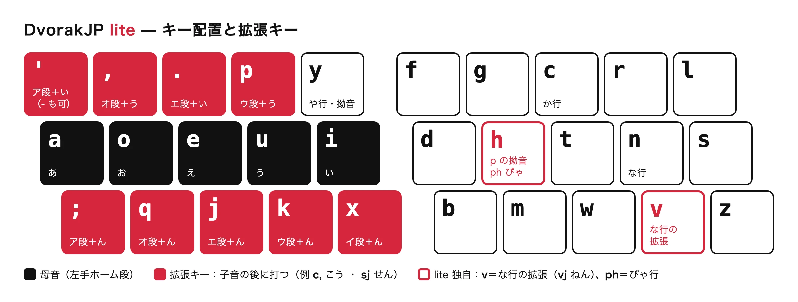

# DvorakJP lite

DvorakJP 拡張ローマ字入力のうち、**QWERTY ローマ字入力と競合しないもの**だけを追加した、ローマ字変換表です。

**公式ページ: https://cafe6a6e.github.io/DvorakJP-lite/** （導入方法・タイピング練習）

## 設計思想

### 1. QWERTY と共存する

元祖 DvorakJP の拡張ルールの一部は、QWERTY ローマ字の「ん」の打ち方と衝突します。

| 打鍵 | QWERTY ローマ字 | 元祖 DvorakJP |
|---|---|---|
| `un.` | うん。 | うねい |
| `enpou` | えんぽう | えぬうおう |
| `konbanha` | こんばんは | こんばにゃ |

DvorakJP lite では、衝突する拡張ルールを次の方針で扱い、QWERTY ローマ字の打ち方を一切変えません。

- **効果の大きいものは、QWERTY ローマ字で打たない組み合わせを最小限使って採用する。** 例:
  - な行の拡張は `n` の代わりに、Dvorak 配列で `n` の真下にある `v` で打つ（`vj` ねん、`v,` のう）
  - ぴゃ行は、Dvorak 配列で `p` と `y` が同じ手で打ちにくいので、h による拗音のうち `ph` だけを採用する（`pha` ぴゃ、`ph,` ぴょう）
- **効果が限定的なものは採用しない。** 例:
  - ぴゃ行以外の`h`,`n`拗音拡張は採用しない。主要な拗音は、QWERTY 同様「子音（右手）、`y`＋母音（左手）」で打つ。

### 2. 記号キーの自由度を担保する

「ア段＋い」は `'` と `-` のどちらでも打てます（`k'` / `k-` → かい）。Dvorak 配列の上段左の記号キーは、好みで `'` と `-` のどちらにしていても使えます。

## DvorakJP との差分サマリ

| ルール | DvorakJP | DvorakJP lite | 補足 |
|---|---|---|---|
| **か行** | `ca` `ci` `cu` `ce` `co` | 維持 | |
| **きゃ行** | `cna` `cnu` `cno`（`kha` 系も可） | `cya` `cyu` `cyo` | h/n 拗音拡張に依存しないため。元祖では `cya` = ちゃ なので意味が異なる |
| **な行＋二重母音** | `n'` `np` `n.` `n,` | `v'` `vp` `v.` `v,` | 出現頻度の低い「ゔぁ行＋二重母音」拡張入力は犠牲にする |
| **な行＋ん** |`n;` `nx` `nk` `nj` `nq` | `v;` `vx` `vk` `vj` `vq` | 出現頻度の低い「ゔぁ行＋ん」拡張入力は犠牲にする |
| **h拗音拡張** | `ph*` `rh*` `nh*` `zh*` etc. | `ph*` のみ採用 | Dvorak 配列で `y` 拗音では打ちにくい「ぴゃ行」に対処する。`nh*` は QWERTY の「ん＋は行」、`zh*` は `zh`(←) と衝突する |
| **n拗音拡張** | `bn*` `hn*` `tn*` `mn*` `gn*` `cn*` etc. | 不採用 | メリットが薄いため採用しない |
| **ア段＋い** | `'` のみ | `'` と `-` | 記号キーの自由度を担保する |
| **z 記号** | `z.` `z,` `zj` `zk` が記号と拡張で重複 | 拡張（ぜい・ぞう・ぜん・ずん）を採用 | 衝突する記号は削除し、記号は `;` で打つ |
| **その他の拡張** | 小書き・くぁ行・すぁ行・つぁ行・とぁ行・てぃ行・うぁ行・ふゃ行・ゔ行などの拡張 | 不採用 | 使用頻度が低いため採用しない |
| **`qu`** | くぅ | く | Google 標準に合わせる |

## 拡張仕様

子音の後に、母音の代わりに拡張キーを打ちます。

|  |  | `'` `-` ア段＋い | `,` オ段＋う | `.` エ段＋い | `p` ウ段＋う | `;` ア段＋ん | `q` オ段＋ん | `j` エ段＋ん | `k` ウ段＋ん | `x` イ段＋ん |
|---|---|---|---|---|---|---|---|---|---|---|
| 直音 | `c` か行 | `c'` `c-` かい | `c,` こう | `c.` けい | `cp` くう | `c;` かん | `cq` こん | `cj` けん | `ck` くん | `cx` きん |
|  | `g` が行 | `g'` `g-` がい | `g,` ごう | `g.` げい | `gp` ぐう | `g;` がん | `gq` ごん | `gj` げん | `gk` ぐん | `gx` ぎん |
|  | `s` さ行 | `s'` `s-` さい | `s,` そう | `s.` せい | `sp` すう | `s;` さん | `sq` そん | `sj` せん | `sk` すん | `sx` しん |
|  | `z` ざ行 | `z'` `z-` ざい | `z,` ぞう | `z.` ぜい | `zp` ずう | `z;` ざん | `zq` ぞん | `zj` ぜん | `zk` ずん | `zx` じん |
|  | `t` た行 | `t'` `t-` たい | `t,` とう | `t.` てい | `tp` つう | `t;` たん | `tq` とん | `tj` てん | `tk` つん | `tx` ちん |
|  | `d` だ行 | `d'` `d-` だい | `d,` どう | `d.` でい | `dp` づう | `d;` だん | `dq` どん | `dj` でん | `dk` づん | `dx` ぢん |
|  | `v` な行 | `v'` `v-` ない | `v,` のう | `v.` ねい | `vp` ぬう | `v;` なん | `vq` のん | `vj` ねん | `vk` ぬん | `vx` にん |
|  | `h` は行 | `h'` `h-` はい | `h,` ほう | `h.` へい | `hp` ふう | `h;` はん | `hq` ほん | `hj` へん | `hk` ふん | `hx` ひん |
|  | `b` ば行 | `b'` `b-` ばい | `b,` ぼう | `b.` べい | `bp` ぶう | `b;` ばん | `bq` ぼん | `bj` べん | `bk` ぶん | `bx` びん |
|  | `p` ぱ行 | `p'` `p-` ぱい | `p,` ぽう | `p.` ぺい | — | `p;` ぱん | `pq` ぽん | `pj` ぺん | `pk` ぷん | `px` ぴん |
|  | `m` ま行 | `m'` `m-` まい | `m,` もう | `m.` めい | `mp` むう | `m;` まん | `mq` もん | `mj` めん | `mk` むん | `mx` みん |
|  | `r` ら行 | `r'` `r-` らい | `r,` ろう | `r.` れい | `rp` るう | `r;` らん | `rq` ろん | `rj` れん | `rk` るん | `rx` りん |
|  | `w` わ行 | `w'` `w-` わい | — | `w.` うぇい | `wp` うう | `w;` わん | — | `wj` うぇん | `wk` うん | `wx` うぃん |
|  | `f` ふぁ行 | `f'` `f-` ふぁい | `f,` ふぉう | `f.` ふぇい | `fp` ふう | `f;` ふぁん | `fq` ふぉん | `fj` ふぇん | `fk` ふん | `fx` ふぃん |
| 拗音 | `y` や行 | `y'` `y-` やい | `y,` よう | `y.` いぇい | `yp` ゆう | `y;` やん | `yq` よん | `yj` いぇん | `yk` ゆん | — |
|  | `cy` `ky` きゃ行 | `cy'` `cy-` きゃい | `cy,` きょう | `cy.` きぇい | `cyp` きゅう | `cy;` きゃん | `cyq` きょん | `cyj` きぇん | `cyk` きゅん | `cyx` きぃん |
|  | `gy` ぎゃ行 | `gy'` `gy-` ぎゃい | `gy,` ぎょう | `gy.` ぎぇい | `gyp` ぎゅう | `gy;` ぎゃん | `gyq` ぎょん | `gyj` ぎぇん | `gyk` ぎゅん | `gyx` ぎぃん |
|  | `sh` `sy` しゃ行 | `sh'` `sh-` しゃい | `sh,` しょう | `sh.` しぇい | `shp` しゅう | `sh;` しゃん | `shq` しょん | `shj` しぇん | `shk` しゅん | `shx` しん |
|  | `j` `jy` `zy` じゃ行 | `j'` `j-` じゃい | `j,` じょう | `j.` じぇい | `jp` じゅう | `j;` じゃん | `jq` じょん | `jyj` じぇん | `jk` じゅん | `jx` じん |
|  | `ch` `ty` ちゃ行 | `ch'` `ch-` ちゃい | `ch,` ちょう | `ch.` ちぇい | `chp` ちゅう | `ch;` ちゃん | `chq` ちょん | `chj` ちぇん | `chk` ちゅん | `chx` ちん |
|  | `dy` ぢゃ行 | `dy'` `dy-` ぢゃい | `dy,` ぢょう | `dy.` ぢぇい | `dyp` ぢゅう | `dy;` ぢゃん | `dyq` ぢょん | `dyj` ぢぇん | `dyk` ぢゅん | `dyx` ぢぃん |
|  | `ny` にゃ行 | `ny'` `ny-` にゃい | `ny,` にょう | `ny.` にぇい | `nyp` にゅう | `ny;` にゃん | `nyq` にょん | `nyj` にぇん | `nyk` にゅん | `nyx` にぃん |
|  | `hy` ひゃ行 | `hy'` `hy-` ひゃい | `hy,` ひょう | `hy.` ひぇい | `hyp` ひゅう | `hy;` ひゃん | `hyq` ひょん | `hyj` ひぇん | `hyk` ひゅん | `hyx` ひぃん |
|  | `by` びゃ行 | `by'` `by-` びゃい | `by,` びょう | `by.` びぇい | `byp` びゅう | `by;` びゃん | `byq` びょん | `byj` びぇん | `byk` びゅん | `byx` びぃん |
|  | `ph` `py` ぴゃ行 | `ph'` `ph-` ぴゃい | `ph,` ぴょう | `ph.` ぴぇい | `php` ぴゅう | `ph;` ぴゃん | `phq` ぴょん | `phj` ぴぇん | `phk` ぴゅん | `phx` ぴぃん |
|  | `my` みゃ行 | `my'` `my-` みゃい | `my,` みょう | `my.` みぇい | `myp` みゅう | `my;` みゃん | `myq` みょん | `myj` みぇん | `myk` みゅん | `myx` みぃん |
|  | `ry` りゃ行 | `ry'` `ry-` りゃい | `ry,` りょう | `ry.` りぇい | `ryp` りゅう | `ry;` りゃん | `ryq` りょん | `ryj` りぇん | `ryk` りゅん | `ryx` りぃん |

- 列は Dvorak 配列の左手のキー順（上段 `'` `,` `.` `p`、下段 `;` `q` `j` `k` `x`）です。
- 同じ行に複数の子音があるものは、どれで打っても同じかなになります。ただし `x` は `ty` `jy` `zy` で打つと ちぃん・じぃん になります（`ch` `j` なら ちん・じん）。
- か行は `k` でも打てます。ただし `kk` は促音になるので、くん は `ck` で打ちます。
- —（打てない組み合わせ）: `pp` は促音（ぷう は `puu` で打ちます）、`w,` `wq` `yx` は拡張なしです。じぇん は `jj` が促音になるので `jyj` で打ちます。

## 記号仕様

記号は `;` で打ちます。Google 標準の z 記号のうち、拡張と衝突するもの（`z-` `z,` `z.` `zk` `zj`）は削除しました。

| 記号 | `;` で打つ | z 記号（Google 標準） |
|---|---|---|
| 〜 | `;-` | 削除（`z-` は ざい） |
| ・ | — | `z/` |
| ‥ | `;,` | 削除（`z,` は ぞう） |
| … | `;.` | 削除（`z.` は ぜい） |
| 『 | `;[` | `z[` |
| 』 | `;]` | `z]` |
| ← | `;d` | `zh` |
| → | `;n` | `zl` |
| ↑ | `;t` | 削除（`zk` は ずん） |
| ↓ | `;h` | 削除（`zj` は ぜん） |

## ファイル

| パス | 内容 |
|---|---|
| `docs/romantable_dvorakjplite.txt` | DvorakJP lite 本体 |

## ライセンス

- **ローマ字テーブル**（`docs/romantable_dvorakjplite.txt`）: [MIT License](LICENSE)。自由に利用・改変・再配布できます。
- **上記以外**（サイトの文章・図・コード・練習用の例文など）: © 2026 cafe6a6e. All rights reserved.
- ローマ字テーブルは Google 日本語入力の標準ローマ字テーブルをもとにしています（Mozc のライセンスは [LICENSE](LICENSE) に記載）。
